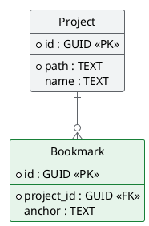

# mde-plantuml — Class diagram e schema del database (ER)

Parte della skill `mde-plantuml`: i due vincoli di MdExplorer, la palette e i livelli del colore sono in `SKILL.md` e valgono anche qui.

## Sintassi del colore

| cosa | sintassi |
|---|---|
| tutte le classi / entità | `skinparam ClassBackgroundColor #F1F3F4` + `ClassBorderColor #5F6368` |
| una categoria | `skinparam class { BackgroundColor<<Nuovo>> #E6F4EA` + `BorderColor<<Nuovo>> #188038 }` |
| una classe, riempimento e bordo | `class Project #E8F0FE;line:1A73E8;line.bold` |
| una relazione, tratto, stile ed etichetta | `Project ..> OldCache #line:D93025;line.dashed;text:D93025 : da rimuovere` |

La forma `;line:` funziona su class, entity e `rectangle`; sul partecipante di un sequence invece fa fallire il diagramma. Se hai un dubbio, lo stereotipo funziona ovunque.

## Class diagram

Regole:

1. **`hide empty members`** sempre: senza, ogni classe si porta dietro due scomparti vuoti che allargano il diagramma per niente.
2. **Mostra solo i membri che servono al punto che stai facendo.** Un class diagram non è la documentazione della classe: quella è il codice.
3. **La cardinalità va su ogni associazione.** `"1"` e `"0..*"` sono l'informazione, la linea da sola non dice nulla.
4. **Scegli il rombo con cognizione**: pieno (`*--`) se il figlio muore col padre, vuoto (`o--`) se sopravvive. Se non sai quale, usa un'associazione semplice.
5. **Etichetta il verso della relazione** (`: contiene >`) quando il nome dell'associazione non è ovvio.
6. `skinparam classAttributeIconSize 0` toglie le icone colorate di visibilità, che rubano l'attenzione ai nomi.
7. **Colora per categoria con uno stereotipo** (nuovo, deprecato, esterno), non classe per classe: l'etichetta «Nuovo» spiega il colore senza legenda.

### Cosa colora MdExplorer da solo, al clic

Cliccando una classe, MdExplorer evidenzia le relazioni con un colore **per tipo**, letto dalla freccia che hai scritto, e la legenda sta nella barra del diagramma (🎨). Il colore non lo scegli tu: scegli la freccia giusta.

| scrivi | tipo | colore al clic |
|---|---|---|
| `<\|--`, `<\|..` | ereditarietà, realizzazione | viola |
| `*--` | composizione | arancione |
| `o--` | aggregazione | azzurro |
| `--`, `..` | associazione | verde acqua |
| `..>` **e anche `-->`** | dipendenza | magenta |

- **Scegli la freccia per quello che significa**, non per come appare: una composizione scritta `-->` si accende come dipendenza.
- ⚠️ **`-->` per PlantUML è una dipendenza**, non un'associazione con verso. Se intendi un'associazione, scrivi `--` e metti il verso nell'etichetta (`: contiene >`).
- **Aggancia ogni nota alla sua classe**: `note right of Classe : …`, oppure `note as N` più `N .. Classe`. Al clic la nota agganciata si accende in giallo; una nota senza legame resta spenta.
- **Non usare di tuo viola, arancione, azzurro, verde acqua o magenta sulle frecce** con un altro significato: la legenda direbbe il falso.

```plantuml
@startuml
!theme plain
hide empty members
skinparam classAttributeIconSize 0
skinparam ClassBackgroundColor #F1F3F4
skinparam ClassBorderColor #5F6368
skinparam ArrowColor #5F6368
skinparam class {
  BackgroundColor<<Nuovo>> #E6F4EA
  BorderColor<<Nuovo>> #188038
}

class Project {
  +Guid Id
  +string Path
  --
  +Open()
}
class Bookmark <<Nuovo>> {
  +string Anchor
}
Project "1" *-- "0..*" Bookmark : contiene >
@enduml
```

## Schema del database (ER)

Regole:

1. **`hide circle`** toglie il pallino da class diagram, che su un'entità non significa niente.
2. **`skinparam linetype ortho`**: le linee a squadra rendono leggibile un reticolo di chiavi esterne dove le diagonali si incrociano.
3. **Marca le chiavi**: `<<PK>>` e `<<FK>>` espliciti, e il `*` di PlantUML davanti alle colonne **NOT NULL**. Separa le chiavi dal resto con `--`.
4. **Il tipo va scritto** (`TEXT`, `GUID`, `INTEGER`): uno schema senza tipi non è uno schema.
5. **Cardinalità a zampa di gallina**: `||--o{` = uno-a-molti opzionale, `||--|{` = uno-a-molti obbligatorio. Sceglila, non copiarla.
6. **Un diagramma per area funzionale.** Lo schema completo di un database vero non si legge: si consulta.
7. **In uno schema si colora la modifica**: la tabella che una migrazione aggiunge o tocca, in linea sull'entità. Tutto il resto neutro.

