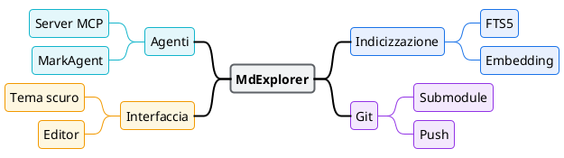

# mde-plantuml — Mindmap

Parte della skill `mde-plantuml`: i due vincoli di MdExplorer, la palette e i livelli del colore sono in `SKILL.md` e valgono anche qui.

## Mindmap

Una mindmap non mostra un flusso né una struttura: mostra **come un argomento si divide**. Si legge dal centro verso fuori, quindi la radice è il titolo e ogni livello è più specifico del precedente.

Si apre con `@startmindmap` e si chiude con `@endmindmap`, sempre dentro un blocco plantuml normale.

Regole:

1. **Una radice, breve**: il nome dell'argomento, non una frase. È l'unico nodo in evidenza.
2. **Da tre a sette rami di primo livello.** Con due, è un elenco; con dodici, sono due mappe.
3. **Al massimo tre livelli sotto la radice.** Il quarto livello è quasi sempre un dettaglio che sta meglio nel testo del documento.
4. **Nodi di poche parole, tutti della stessa natura** (tutti sostantivi, o tutti azioni). Un nodo che è una frase intera va spezzato o spostato nel documento.
5. **Bilancia i lati**: con più di quattro rami, metti metà dei rami a sinistra con `left side` (sintassi a asterischi) o con `-` al posto di `+`.
6. **Le foglie di puro dettaglio vanno senza box** (`***_ dettaglio`): pesano meno sulla pagina e lasciano spiccare i nodi che contano.
7. **Testo su più righe** con `**:prima riga` e `seconda riga;`, non allargando il nodo.

### Colore nella mindmap: scegli UNA strategia

Nella mindmap il colore può dire due cose diverse, e **non vanno mai mischiate** nella stessa mappa:

- **Per stato** — la struttura è neutra e colori solo i nodi che hanno un esito: fatto, a rischio, bloccato. Vale la regola dei tre colori, e la palette è quella con significato (verde, ambra, rosso).
- **Per ramo** — ogni ramo di primo livello ha la sua tinta, e tutti i suoi discendenti la ripetono. Qui il colore dice *"appartiene a questo ramo"* e aiuta a seguire i rami nelle mappe grandi. Si possono usare fino a cinque tinte, ma **solo quelle senza giudizio**: blu, viola, ciano, più verde e ambra se servono. Il rosso no, sembrerebbe un errore.

Se la mappa ha meno di quattro rami, non colorarla per ramo: la struttura si vede già.

### Come si imposta il colore della mindmap

La mindmap si colora con un blocco **`<style>`**, non con gli `skinparam`: `<style>` sa distinguere la radice, i livelli, le foglie e le classi che definisci tu, e tiene tutto il colore in un posto solo.

```text
<style>
mindmapDiagram {
  node      { ... }   tutti i nodi: il neutro
  arrow     { ... }   i rami che non prendono il colore da un nodo
  :depth(0) { ... }   la radice
  :depth(1) { ... }   i nodi di primo livello (e così via)
  leafNode  { ... }   le foglie che hanno un box
  boxless   { ... }   i nodi senza box (***_), solo testo
  .nome     { ... }   una classe: si applica con <<nome>> sul nodo
}
</style>
```

Proprietà utili: `BackgroundColor`, `LineColor`, `LineThickness`, `FontColor`, `FontSize`, `FontStyle bold`, `RoundCorner`, `Padding`, `Margin`.

Quattro comportamenti provati sul jar, che non si indovinano:

- **Il `LineColor` di un nodo colora anche il ramo che esce da lui**, verso i figli. Quindi la radice con tratto blu ha i rami di primo livello blu; un nodo di ramo viola ha i collegamenti verso i figli viola.
- **Una classe `<<nome>>` non passa ai figli.** Per colorare un ramo intero, metti la classe su **ogni** nodo del ramo.
- **`leafNode` non tocca i nodi senza box**: quelli si stilizzano con `boxless`, di solito col solo `FontColor`, visto che non hanno un riempimento.
- **Il colore in linea** `**[#FCE8E6] nodo` imposta il solo riempimento: il bordo resta quello di default. Usalo per un'eccezione unica; per tutto il resto, una classe.

### Esempio: colore per stato

Struttura neutra, radice in evidenza, colore solo sull'esito. Le foglie di dettaglio sono senza box.


Legenda implicita: verde fatto, ambra a rischio, rosso bloccato. Se la mappa va a qualcuno che non conosce la convenzione, aggiungi `legend` come negli altri diagrammi.

### Esempio: colore per ramo

Ogni ramo di primo livello ha una tinta senza giudizio e **ogni** suo nodo porta la classe. La radice è l'unico nodo con tratto spesso.


