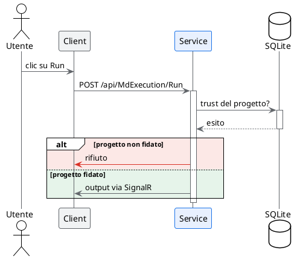

# mde-plantuml — Sequence diagram

Parte della skill `mde-plantuml`: i due vincoli di MdExplorer, la palette e i livelli del colore sono in `SKILL.md` e valgono anche qui.

## Sintassi del colore

| cosa | sintassi |
|---|---|
| tutti i partecipanti | `skinparam ParticipantBackgroundColor #F1F3F4` + `ParticipantBorderColor #5F6368` |
| linee di vita | `skinparam SequenceLifeLineBorderColor #5F6368` |
| un partecipante, solo riempimento | `database "SQLite" as DB #FEF7E0` |
| un partecipante con bordo | stereotipo: `skinparam participant { BackgroundColor<<Focus>> #E8F0FE ... }` e `participant "Service" as S <<Focus>>` |
| una freccia | `S -[#D93025]> Utente : rifiuto` |
| un blocco alt/else, ramo per ramo | `alt #FCE8E6 non trusted` … `else #E6F4EA trusted` |
| un gruppo di partecipanti | `box "Backend" #F1F3F4` … `end box` |
| una nota | `note right of S #FEF7E0 : il costo sta qui` |

⚠️ **Nel sequence `#riempimento;line:colore` sul partecipante fa fallire il diagramma** ("No such color"): il bordo di un singolo partecipante si colora solo con lo stereotipo.

## Sequence diagram

Regole:

1. **Le barre di attivazione non sono facoltative**: `++` e `--` mostrano chi ha il controllo in quel momento, che è metà del significato del diagramma.
2. **La risposta si scrive con `return`**, non con una freccia tratteggiata a mano: si allinea da sola all'attivazione giusta.
3. **Freccia piena per la chiamata, tratteggiata per la risposta.** È l'unica convenzione che tutti leggono senza legenda.
4. **Da tre a sette partecipanti.** Oltre, il diagramma diventa un muro: spezzalo per caso d'uso.
5. **Gli alias accorciano, non nascondono**: `participant "Service .NET" as S` va bene, `participant S` no.
6. Usa `group` / `alt` solo quando il raggruppamento **cambia la lettura**; se serve solo a fare ordine, toglilo.
7. **Colora il ramo `alt`, non i partecipanti**: il rosso sul ramo che fallisce dice cosa succede; un partecipante rosso non dice niente. Un partecipante si mette in evidenza solo se è il soggetto del diagramma.

