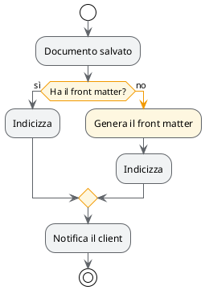

# mde-plantuml — Workflow (activity diagram)

Parte della skill `mde-plantuml`: i due vincoli di MdExplorer, la palette e i livelli del colore sono in `SKILL.md` e valgono anche qui.

## Sintassi del colore

| cosa | sintassi |
|---|---|
| tutte le azioni | `skinparam ActivityBackgroundColor #F1F3F4` + `ActivityBorderColor #5F6368` |
| i rombi delle decisioni | `skinparam ActivityDiamondBackgroundColor #FEF7E0` + `ActivityDiamondBorderColor #F29900` |
| una sola azione | `#FCE8E6:Rifiuta il salvataggio;` |
| tutte le frecce | `skinparam ArrowColor #5F6368` |
| una freccia, anche spessa, con etichetta | `-[#D93025,bold]-> errore;` |
| una corsia (swimlane) | `\|#E8F0FE\|Client\|` |
| un gruppo di azioni | `partition #E6F4EA "Pubblicazione" { ... }` |

## Workflow (activity diagram)

Regole:

1. **Un solo `start` e, se possibile, un solo `stop`.** Più uscite significano quasi sempre due diagrammi.
2. **Le condizioni si scrivono come domande** e i rami portano la *risposta*, non un generico sì/no fuori contesto: `if (Ha il front matter?) then (sì)`.
3. **Il ramo normale scende dritto**, quello eccezionale devia. Chi legge segue la colonna centrale.
4. **Colora solo il ramo eccezionale.** Un activity tutto colorato non ha più un percorso principale. Colora l'azione *e* la freccia che ci porta: così il ramo si segue anche a colpo d'occhio.
5. Ogni azione è un **verbo all'imperativo o all'infinito**, non un sostantivo: «Genera il front matter», non «Generazione front matter».
6. **Le corsie si colorano solo se distinguono chi agisce** (utente, client, service). Una corsia in evidenza al massimo: le altre restano neutre.

