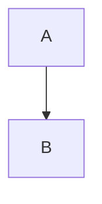

<!--
MdExplorer-managed skill.
The `mde:` block above marks this file as distributed by MdExplorer. When you
open a project, MdExplorer compares the embedded version with what is on disk
and will overwrite this file to keep it in sync with the current MdExplorer
features. To customize the skill while keeping your edits, remove the `mde:`
block (or change `origin` to something else) — MdExplorer will then leave the
file alone.
-->

# Presentazioni in MdExplorer

Una presentazione è **un file markdown**. MdExplorer lo legge con lo stesso motore dei documenti e lo mostra
come presentazione **reveal.js 6**. Il file resta leggibile e modificabile come qualunque altro `.md`, e il
pulsante **PDF** della barra lo esporta.

Tutto ciò che reveal.js sa fare si scrive in uno di **quattro livelli**. Se una cosa non compare in questa
skill, la documentazione ufficiale di reveal.js (revealjs.com) vale anche qui, con queste stesse forme:

| Livello | Dove si scrive |
|---|---|
| tutta la presentazione | `reveal.config` nel front matter: le opzioni di `Reveal.initialize`, così come sono |
| una slide | un commento `<!-- .slide: … -->` dentro la slide |
| un elemento | un commento `<!-- .element: … -->` subito dopo l'elemento |
| il resto | HTML scritto direttamente nel markdown |

## Prima di scrivere

Una slide dice **una cosa sola**. Se il titolo non basta a capire di cosa parla, dividila.

Prima di scrivere, chiarisci con l'utente, se non lo ha già detto:

- a chi è rivolta e quanto deve durare. Circa una slide al minuto è un buon punto di partenza;
- se la proietta parlando (poco testo e note del relatore) o se la manda da leggere (testo più completo,
  niente effetti);
- se serve il PDF. Gli effetti a comparsa nel PDF diventano più pagine, vedi «Mi serve il PDF» in `struttura-ed-esportazione.md`.

Se non puoi chiedere, decidi e dillo all'utente quando consegni:

- **tema esplicito** (`reveal.theme`), non quello che segue MdExplorer: se la presentazione usa sfondi colorati o
  diagrammi, il suo aspetto non deve cambiare con il tema dell'app. `white` è la scelta più sicura;
- **dimensioni**: reveal.js parte da 960×700. Per uno schermo 16:9 scrivi `width: 1280` e `height: 720` in
  `reveal.config`;
- **effetti a comparsa** solo se la presenta parlando; **note del relatore** sempre, se la presenta parlando.

## Se la presentazione esiste già

**Rileggi il file subito prima di modificarlo.** L'utente lo cambia anche a mano dalla pagina — trascina le voci,
corregge un testo, sceglie le transizioni — e ogni gesto scrive nel `.md`. Ciò che hai letto o scritto qualche
messaggio fa può essere vecchio: se riscrivi partendo da quello, **cancelli il suo lavoro**. Cambia solo le righe che
ti servono, a partire da ciò che leggi adesso.

## Quando l'utente presenta

Nella vista di MdExplorer la barra delle slide ha **▶ Presenta** (lo stato all'apertura, con i link che funzionano) e
**✏ Modifica**, più **⛶ schermo intero**. In Presenta c'è **🖍**, per **annotare** la slide mentre si presenta: penna,
evidenziatore, gomma, sei colori e «Azzera». Le annotazioni **non finiscono nel file**: restano sulla slide finché la
pagina non si ricarica. **A schermo intero la barra resta**: si continua a presentare, correggere e annotare. Ci sono
anche i tasti **A** (annotazioni sì/no), **E** (gomma) e **C** (cancella la slide). Una **pagina HTML del progetto** aperta da una slide ha la stessa barra con 🖍 e ⛶ (senza Presenta/Modifica): si annota
e si mette a schermo intero anche lei. Sopra un diagramma, al passaggio del mouse, ci sono i pulsanti di **zoom**
(− percentuale +; la percentuale riporta alla dimensione originale) e l'**occhio 👁**, che mostra il diagramma **a tutta
pagina** (lì si può ancora annotare con 🖍); l'occhio di nuovo, o Esc, lo riporta nella slide. Se l'utente chiede come fare, dillo così.

## Lo scheletro

````markdown esempio=scheletro
---
title: Revisione trimestrale
document_type: slides
---

# Revisione trimestrale

Area vendite · settembre 2026

---

## Risultati

- Fatturato +12%
- Quaranta clienti nuovi

---

## Prossimi passi

1. Consolidare i clienti nuovi
2. Aprire il mercato tedesco
````

- `document_type: slides` nel front matter è ciò che fa del file una presentazione. Senza, è un documento.
- `title` nel front matter non compare sulle slide: è il titolo della scheda e del PDF. Il titolo visibile è
  il `#` della prima slide.
- **Una riga `---` da sola separa due slide.**
- Il titolo della prima slide con `#`, quelli delle altre con `##`.

## Tre regole del motore, da non sbagliare

1. **Una riga `---` è sempre un separatore**, anche attaccata al testo sopra. `Titolo` seguito da `---`
   nei documenti è un titolo, qui divide la slide in due. Per i titoli usa `##`, per una riga orizzontale
   `***`.
2. **Dentro un blocco di codice nulla è un separatore.** Un `---` in un blocco YAML resta codice.
3. **Una riga che comincia con `Note:` trasforma il resto della slide in note del relatore**, che il pubblico
   non vede. Il testo delle note può cominciare sulla stessa riga (`Note: dire che…`) e finisce al separatore
   successivo (`---` o `--`). Non scrivere `Note:` all'inizio di una riga quando vuoi che si veda.

## Ricette: cosa vuole l'utente → dove leggere

Le ricette sono in file accanto a questo, nella cartella della skill. **Prima di scrivere una cosa che vedi qui sotto, leggi il file indicato**: ha la forma esatta e gli errori da evitare.

| L'utente vuole… | Leggi |
|---|---|
| «I punti devono comparire uno alla volta» | `contenuto.md` |
| «Con effetti diversi, e in un ordine preciso» | `contenuto.md` |
| «Voglio degli approfondimenti che si possono saltare» | `contenuto.md` |
| «Mi servono gli appunti mentre parlo» | `contenuto.md` |
| «Codice evidenziato un pezzo alla volta» | `contenuto.md` |
| «Un diagramma» | `contenuto.md` |
| «Una formula» | `contenuto.md` |
| «Due colonne» | `contenuto.md` |
| «Un'immagine o una GIF trovata in rete» | `contenuto.md` |
| «Questa slide deve avere uno sfondo diverso» | `aspetto.md` |
| «Come sfondo voglio un video, anche di YouTube, che si muove» | `aspetto.md` |
| «Questa slide deve entrare in un altro modo» | `aspetto.md` |
| «Un elemento che si sposta da una slide alla successiva» | `aspetto.md` |
| «Più immagini una sopra l'altra, che si alternano» | `aspetto.md` |
| «La presentazione deve comportarsi in un certo modo» | `aspetto.md` |
| «Un altro aspetto» | `aspetto.md` |
| «Nello stile di MdExplorer»: lo spazio, i razzi, gli alieni | `aspetto.md` |
| «Una presentazione principale che porta alle sezioni» | `struttura-ed-esportazione.md` |
| «Mi serve il PDF» | `struttura-ed-esportazione.md` |
| «La devo mandare a qualcuno che non ha MdExplorer» | `struttura-ed-esportazione.md` |

## Errori che MdExplorer segnala

Quando il file non si può mostrare così com'è, al posto della presentazione compare un messaggio, in inglese,
che dice cosa correggere. I più comuni:

````markdown esempio=errore-opzione-fuori-posto
---
title: Sbagliato
document_type: slides
reveal:
  transition: fade
---

# Sbagliato
````

→ `Unknown key 'reveal.transition'`: le opzioni di reveal.js vanno sotto `reveal.config`.

````markdown esempio=errore-mermaid
## Il flusso


````

→ `Mermaid diagrams are not shown in slides`: usa PlantUML.

Anche un tema che non esiste, uno YAML non valido (il messaggio dice la riga) o `plugins` in `reveal.config`
danno un messaggio di questo tipo.

## Checklist

- [ ] Il front matter ha `document_type: slides`.
- [ ] Ogni slide ha un titolo e dice una cosa sola.
- [ ] Le slide sono separate da `---` su una riga da sola, e nessun `---` di testo divide una slide per sbaglio.
- [ ] Le opzioni di reveal.js stanno sotto `reveal.config`; `theme` e `highlight_theme` sotto `reveal:`.
- [ ] Booleani e numeri in `reveal.config` sono senza virgolette.
- [ ] I diagrammi sono PlantUML, senza backtick dentro il blocco.
- [ ] Chi presenta parlando ha le sue note (`Note:`); chi manda la presentazione da leggere non usa effetti a
      comparsa, o mette `pdfSeparateFragments: false`.
