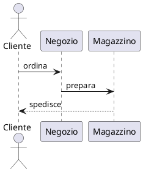

# mde-slide — Ricette per il contenuto

Parte della skill `mde-slide` (punti a comparsa, slide verticali, note del relatore, codice, diagrammi, formule, colonne, immagini prese dalla rete). Le regole che valgono sempre (scheletro, separatori, `Note:`, errori, checklist) sono in `SKILL.md`.

### «I punti devono comparire uno alla volta»

Un commento `.element` alla fine di ogni punto:

````markdown esempio=frammenti
## Perché cambiare

- Costi in crescita <!-- .element: class="fragment" -->
- Clienti che chiedono tempi più brevi <!-- .element: class="fragment" -->
- Un concorrente nuovo <!-- .element: class="fragment" -->
````

Il commento si applica all'elemento **prima** di lui: scritto alla fine di un punto, vale per quel punto.
Scritto sulla riga sotto l'elenco vale per l'ultimo punto; dopo una riga vuota, per l'elenco intero. Funziona
allo stesso modo negli elenchi numerati e nel markdown dentro un blocco HTML (per esempio nelle colonne).

### «Con effetti diversi, e in un ordine preciso»

`class` sostituisce la classe dell'elemento: scrivi sempre anche `fragment`. Con `data-fragment-index` gli
elementi compaiono nell'ordine indicato, anche se nel testo sono in un altro ordine.

````markdown esempio=frammenti-ordine
## Il piano

La meta <!-- .element: class="fragment fade-up" data-fragment-index="2" -->

Il punto di partenza <!-- .element: class="fragment fade-in" data-fragment-index="1" -->

Il rischio da evitare <!-- .element: class="fragment highlight-red" data-fragment-index="3" -->
````

Effetti utili: `fade-in`, `fade-up`, `fade-down`, `fade-out`, `grow`, `shrink`, `strike`,
`highlight-red`, `highlight-green`, `highlight-blue`.

### «Voglio degli approfondimenti che si possono saltare»

Le slide **verticali**: `--` su una riga da sola apre una slide sotto quella corrente. Chi presenta scende con
↓ o salta alla slide successiva con →.

````markdown esempio=verticali
## Tre mercati

---

## Italia

--

## Italia: i numeri

--

## Italia: i rischi

---

## Germania
````

### «Mi servono gli appunti mentre parlo»

````markdown esempio=note
## Risultati

- Fatturato +12%

Note:
Dire subito che il dato di settembre è provvisorio.
Se chiedono dei margini: slide 7.
````

Le note le vede solo chi presenta, nella **vista relatore**: il tasto **S** sulla presentazione apre una
finestra a parte con la slide corrente, la successiva, le note e il tempo. Le note accettano il markdown.

### «Codice evidenziato un pezzo alla volta»

Dopo il linguaggio, tra parentesi quadre, i gruppi di righe separati da `|`. Ogni gruppo è un passo.

````markdown esempio=codice
## Il ciclo

```js [1-2|4|5-7]
const clienti = await carica();
const attivi = clienti.filter(c => c.attivo);

for (const c of attivi) {
  if (c.scaduto) {
    avvisa(c);
  }
}
```
````

`[1-2]` senza `|` evidenzia quelle righe e basta; `[]` mostra solo i numeri di riga; `[10: 1-2]` fa partire la
numerazione da 10.

### «Un diagramma»

Con **PlantUML**, come nei documenti. Nella slide diventa un `<svg>` dentro la pagina, non un'immagine. Per
lo stile dei diagrammi vale la skill `mde-plantuml`.

````markdown esempio=diagramma
## Come passa un ordine


````

- **Niente mermaid**: un blocco `mermaid` in una presentazione dà un errore. Usa PlantUML.
- Un diagramma troppo grande viene **rimpicciolito** per stare nella slide (in larghezza, e in altezza fino a
  tre quarti della slide); non viene mai ingrandito. Rimpicciolito troppo diventa illeggibile: oltre una
  dozzina di riquadri, o con testi lunghi nei riquadri, dividilo in due slide.
- Nei documenti in tema scuro MdExplorer ribalta i colori del diagramma (`filter: invert`), **nelle slide
  no**: il diagramma resta com'è, e su un tema scuro compare come un riquadro chiaro. Scegli un tema chiaro,
  oppure dai al diagramma colori pensati per lo sfondo scuro.

### «Una formula»

Come nei documenti: `$…$` nel testo, `$$…$$` su righe proprie. Un `$` da solo resta un `$`.

````markdown esempio=formula
## Crescita composta

Il capitale dopo $n$ anni:

$$
C_n = C_0 (1 + r)^n
$$
````

### «Due colonne»

````markdown esempio=colonne
## Prima e dopo

<div class="r-hstack">
<div style="flex:1">

**Prima**

- Tre sistemi
- Dati copiati a mano

</div>
<div style="flex:1">

**Dopo**

- Un sistema
- Dati allineati da soli

</div>
</div>
````

Il markdown dentro un `<div>` funziona se c'è una riga vuota tra il tag e il testo.

### «Un'immagine o una GIF trovata in rete»

Quando l'utente chiede un'immagine, una GIF o un'animazione «che trovi in rete», **non mettere mai nella slide
l'indirizzo esterno** (``): un link a un altro sito può sparire, non funziona senza rete, e non finisce nel
PDF né nel commit. Si **scarica nel progetto** e la slide punta al file:

1. scarica con la shell nella cartella `assets/` del progetto (o quella già usata per le immagini), per esempio
   `curl -L -o assets/samurai.gif "<url diretto al file>"`;
2. controlla che sia davvero un'immagine (`file assets/samurai.gif`) e che la dimensione sia ragionevole (una GIF di
   decine di MB rallenta la presentazione);
3. scrivi il percorso **relativo al file**: ``, dove serve anche accanto al testo con
   le due colonne (ricetta «Due colonne»);
4. preferisci fonti con licenza chiara (Wikimedia Commons, con la sua API interrogabile con `curl`, dice licenza e
   autore) e scrivila in una nota o nella didascalia; Giphy e Tenor hanno condizioni d'uso per l'uso in un progetto.

Se non trovi un indirizzo affidabile dillo all'utente, **senza inventare un URL**: può darti lui l'indirizzo diretto
del file.
